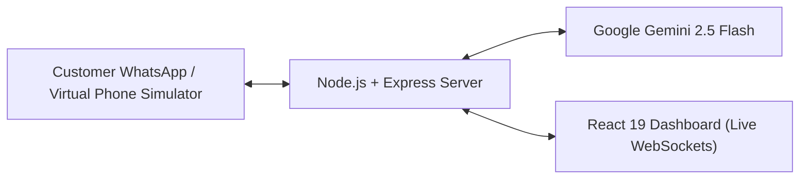

# WhatsApp AI Persona Agent

A self-hosted dashboard to manage AI-powered WhatsApp conversations. It lets you create custom personas (such as Customer Support, Sales Rep, or Technical Assistant), assign them to specific contacts or tags, test conversations directly with a built-in virtual phone simulator, and dispatch broadcast campaigns.

Built with Google Gemini 2.5 Flash, React, Node.js, and live WebSocket updates.



## Features

- **Custom AI Personas**: Create distinct personalities with custom system instructions, tones, and knowledge. Switch active personas or assign specific personas to individual contacts.
- **Built-in Virtual Phone Simulator**: Test conversations from a customer's perspective inside your browser without needing a physical phone or an active Meta business setup.
- **Live Inbox & Human Takeover**: Monitor customer chats in real time. Pause AI automation or take over manually with a single click.
- **Delivery Receipts**: Accurate message statuses with WhatsApp checkmarks (`sent` ✓, `delivered` ✓✓, `read` ✓✓).
- **Contact CRM & Tagging**: Organize customer contacts with tags, notes, and custom assigned personas.
- **Broadcast Campaigns**: Send instant or scheduled announcements to selected contact lists or tag groups.
- **Meta WhatsApp Cloud API Integration**: Seamlessly switch from simulator testing to production Meta WhatsApp Cloud API webhooks and messaging.
- **Zero-Config Local Storage**: Stores contacts, chats, and configurations in atomic, cached local JSON files. No external database setup required.

## Tech Stack

- **Frontend**: React 19, TypeScript, Vite, Tailwind CSS, Lucide Icons, Recharts
- **Backend**: Node.js, Express, Socket.io
- **AI Engine**: Google Gemini API (`@google/genai` with `gemini-2.5-flash`)
- **Storage**: Atomic JSON files stored locally in `./db-data/`

## Quick Start

### 1. Clone & Install
```bash
git clone https://github.com/harshabk22/Customizable-persona-whatsapp-agent.git
cd Customizable-persona-whatsapp-agent
npm install
```

### 2. Configure Environment
Copy the `.env.example` file to `.env`:
```bash
cp .env.example .env
```

Open `.env` and add your Gemini API key:
```env
GEMINI_API_KEY="your_gemini_api_key_here"
```
*(If left empty, the application automatically runs in demo mode with intelligent fallback responses so you can test immediately.)*

### 3. Run the Development Server
```bash
npm run dev
```
Open [http://localhost:3000](http://localhost:3000) in your browser.

## Environment Variables

| Variable | Required | Description |
| :--- | :--- | :--- |
| `PORT` | Optional | Web server port (defaults to `3000`) |
| `JWT_SECRET` | Optional | Secret key for auth tokens |
| `GEMINI_API_KEY` | Recommended | Google Gemini API key for live AI generation |
| `WHATSAPP_API_TOKEN` | Optional | Meta WhatsApp Cloud API System User access token |
| `WHATSAPP_PHONE_NUMBER_ID` | Optional | Meta WhatsApp Business phone number ID |
| `WHATSAPP_VERIFY_TOKEN` | Optional | Custom verification token for Meta webhook setup |

## Connecting Real WhatsApp (Meta Cloud API)

When you are ready to connect a live business number:
1. Go to the [Meta for Developers Portal](https://developers.facebook.com/) and create a WhatsApp App.
2. Under WhatsApp settings, copy your **Phone Number ID** and generate a **System User Access Token**.
3. Add these credentials to your `.env` file.
4. Set your Webhook URL in Meta to: `https://your-domain.com/api/whatsapp/webhook`
5. Enter the `WHATSAPP_VERIFY_TOKEN` you specified in `.env`.
6. Subscribe to the `messages` webhook field.

## Project Structure

```
├── server.ts              # Express API, Socket.io, Gemini integration & webhooks
├── src/
│   ├── App.tsx            # Main shell, socket setup & view router
│   ├── db.ts              # File-based database with cached atomic reads/writes
│   ├── types.ts           # Shared TypeScript models
│   └── components/
│       ├── Auth.tsx          # Login & registration screen
│       ├── Dashboard.tsx     # KPI metrics, response charts & activity logs
│       ├── Conversations.tsx # Live chat, human takeover & phone simulator
│       ├── Personas.tsx      # Persona editor & system prompt configuration
│       ├── Contacts.tsx      # Contact list with tag filters & persona assignment
│       ├── Broadcast.tsx     # Mass announcement scheduler & progress tracker
│       └── Settings.tsx      # Business hours, response delays & API keys
├── .env.example           # Environment template
└── package.json           # Scripts and project dependencies
```

## Available Scripts

- `npm run dev`: Runs the full-stack server with live reloading on port 3000.
- `npm run build`: Compiles the frontend via Vite and backend via esbuild into `dist/`.
- `npm run start`: Starts the compiled production server.
- `npm run lint`: Performs TypeScript type checks across the codebase.

## License

MIT
